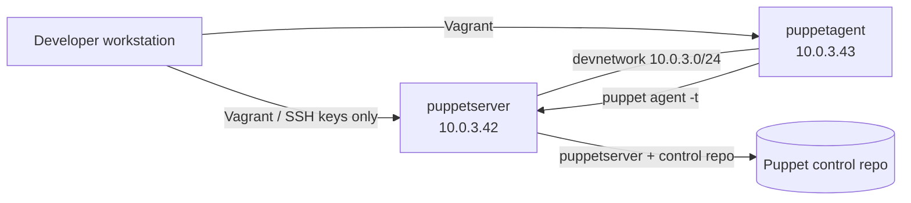

# Deep analysis and modernization decisions

## Scope

The original stack was a single root `Vagrantfile` (72 lines), two Puppet config
files plus duplicated `.example` copies, a YAML config and its template, and a
one-line README. This document records what was wrong with it, the threat model
used for the rewrite, and why each design choice was made. See
[SECURITY.md](SECURITY.md) for secret-handling and incident follow-up.

## Findings in the original stack

| # | Severity | Finding | Evidence | Remediation in this rewrite |
| --- | --- | --- | --- | --- |
| 1 | Critical | Unsafe YAML deserialization | `YAML::load_file("puppetdev_vagrant.config.yaml")` allowed arbitrary object instantiation on older Ruby/Psych (a classic RCE vector). | `YAML.safe_load(..., aliases: true)` plus an explicit schema validator shared by Ruby and Python. |
| 2 | Critical | Secrets committed to git history | Commits `5b54837`, `041417f`, `ffef0ab`, `6dca21d` deleted eyaml keys and a deploy key pair. Deletion from HEAD does not remove history. | All secrets removed from worktree, `vagrant/secrets/` ignored with broad patterns, `secrets/` documented, gitleaks in CI. Rotation is a manual action - see SECURITY.md. |
| 3 | High | Broken provisioning | The Vagrantfile file-provisioned `puppetdev_deploykey`, `puppetdev_deploykey.pub` and two `.pem` files that no longer exist, so `vagrant up` failed immediately. | Secrets are optional; missing files produce a warning and a HTTPS fallback. |
| 4 | High | End-of-life base image | `debian/jessie64` (Debian 8) has been unsupported since 2018, with no security updates; its `puppetmaster-passenger` packages are gone. | Pinned `debian/bookworm64` (Debian 12) with Puppet 8 from Puppet's signed apt repository. |
| 5 | High | Password-based SSH | `ssh.password = 'vagrant'` on both nodes defeats key-only hardening and invites brute force. | `ssh.keys_only = true`, `ssh.insert_key = true`, no password, agent and X11 forwarding disabled. |
| 6 | High | Blind SSH host trust | `ssh-keyscan -H github.com > ~/.ssh/known_hosts` trusts whatever a MITM presents. | Removed. HTTPS by default; SSH uses a pinned identity file and `StrictHostKeyChecking=accept-new` (TOFU that persists). |
| 7 | Medium | Unverifiable provisioning | A 40-line inline heredoc with `sudo` on every line, no `set -e`, no `pipefail`, no idempotency, no linting. | External scripts with `set -Eeuo pipefail`, shared helpers, `write_if_changed` and `add_host_alias` for idempotency; shellcheck in CI. |
| 8 | Medium | Large attack surface | Dozens of `*-doc`, `*-dbg`, debug and multilib packages (`gdb`, `strace`, `tcpdump`, `dkms`, ...) on a dev master. | Only `ca-certificates`, `curl`, `git`, `puppetserver` / `puppet-agent`, installed with `--no-install-recommends`. |
| 9 | Medium | Hardcoded network | IPs `10.0.3.42/43` and `10.0.3.42 puppet` baked into the Vagrantfile and shell scripts. | IPs computed from `network.subnet` + per-node `ip_octet`, validated for range and uniqueness; hosts aliases generated from config. |
| 10 | Medium | Unpinned, unverified box | `config.vm.box` alone silently tracks whatever Vagrant Cloud serves. | Immutable `box.version`, optional `box.checksum`, and a scheduled workflow that proposes box upgrades as PRs. |
| 11 | Medium | Legacy Puppet layout | `/etc/puppet`, `puppetmaster-passenger`, `parser = future` and `$confdir` semantics removed in modern Puppet. | Puppet 8 paths under `/etc/puppetlabs/puppet`, `puppetserver` service, Puppet CA CLI for certs. |
| 12 | Low | Default synced folder | Vagrant mounted the host workspace at `/vagrant` in the guest, exposing local files (potentially secrets) unnecessarily. | `synced_folder ".", "/vagrant", disabled: true`; provisioners upload only the files they need. |
| 13 | Low | GUI by default | `c.gui = true` wastes resources and fails on headless CI hosts. | Headless by default, opt-in via `gui: true` or `PUPPETDEV_GUI=true`. |
| 14 | Low | No validation or CI | Nothing checked syntax, schema or secrets; the README was a single heading. | `make check` gate, GitHub Actions CI, Dependabot, and three documentation pages. |
| 15 | Low | Drifting configuration | Real `.conf` files and `.example` copies differed (`environment = dev`, different `dns_alt_names`). | Guest config generated from one validated source of truth; `vagrant/puppet/*.example` are documentation only. |
| 16 | Low | No resource/timeout policy | No `boot_timeout`, no linked clones, inconsistent RAM (master had 1 GB, agent 2 GB). | Explicit timeouts, linked clones, `vm.name`, IO APIC/DNS tweaks, and server-weighted resources. |

## Threat model

The stack is a **local development environment**, not a production platform.
The controls still assume that:

- the developer workstation may hold reusable credentials;
- the control repository and box come from external suppliers (supply chain);
- everything checked into git is public to anyone with repository access, now
  and in the future;
- a compromised guest must not gain host credentials or a host workspace mount.

Consequences: no secrets in git, key-only SSH with no agent forwarding, no
host/guest shared folder, pinned and checksum-capable boxes, signed apt
repositories, and least-privilege, idempotent bootstrap scripts.

The one deliberate relaxation is **name-based autosigning** for the dev domain.
It exists so a fresh agent can enroll without manual CA steps. It is explicitly
documented as unsafe outside this isolated network.

## Design decisions

| Decision | Rationale |
| --- | --- |
| Stack under `vagrant/` | Keeps the repository root for repository-level concerns (docs, Makefile, CI) and makes the unit of execution obvious. |
| `YAML.safe_load` + schema validator | Prevents deserialization gadgets and gives actionable errors before Vagrant touches a provider. The Python validator mirrors the Ruby checks so CI needs no Vagrant. |
| Config-driven IPs via `IPAddr \| octet` | Avoids collisions and hardcoded values while staying readable; validation rejects out-of-range or duplicate octets. |
| Two providers (VirtualBox + libvirt) | Vagrant ignores the inactive provider block; developer laptops can use VirtualBox while CI/homelabs can use libvirt. |
| Immutable box version | Reproducible builds; upgrades are explicit, reviewed PRs from the scheduled workflow. |
| Optional secrets with graceful fallback | A fresh clone must `vagrant up` successfully without private material, while still supporting a private control repo. |
| External, idempotent shell scripts | They can be linted, reviewed and re-run; `set -Eeuo pipefail` makes failures loud and `write_if_changed` avoids config churn. |
| Staged library + files | Vagrant uploads only the files listed as provisioners; `common.sh` is staged explicitly and sourced from `PUPPETDEV_LIB`. |
| Generated guest config | One source of truth in YAML; the `puppet/` examples document the expected output without being copied verbatim. |
| Onetime Puppet agent | Avoids an unmanaged daemon in a dev VM; enrollment is opt-in via `PUPPET_ENROLL=true`. |
| Headless default, key-only SSH, no synced folder | Reduces resource use and the guest-to-host attack surface. |

## Topology and provisioning sequence



Per VM, `vagrant up` runs:

1. `scripts/prepare.sh` - creates `/tmp/puppetdev/{lib,secrets}` with `0700`.
2. file provisioner - uploads `scripts/lib/common.sh`.
3. file provisioners - upload each secret that actually exists locally.
4. `bootstrap-server.sh` or `bootstrap-agent.sh` - installs Puppet from the
   signed Puppet apt repo, renders config, clones the control repo (server),
   and manages the service/enrollment.

## Dependency update strategy

| Dependency class | Manifest | Automation |
| --- | --- | --- |
| Python tooling | `requirements-dev.txt` | Dependabot `pip`, weekly, grouped |
| Ruby / Vagrant tooling | `vagrant/Gemfile` | Dependabot `bundler`, weekly, grouped |
| GitHub Actions | `.github/workflows/*.yml` | Dependabot `github-actions`, weekly, grouped |
| Vagrant box | `vagrant/config/default.yaml` | `box-update.yml`, weekly, opens a PR |

All four paths converge on `make STRICT=1 check` in CI.

## Verification

Run locally before committing:

```bash
make check
make STRICT=1 check   # proves no tool is silently skipped
```

`make check` performs config validation, `vagrant validate --ignore-provider`
(so CI needs no hypervisor), YAML/shell/Ruby linting, the insecure-pattern
audit, gitleaks, pip-audit and the box-freshness check. Tools that are not
installed are reported as `SKIP` unless `STRICT=1`. The one known historical
secret finding is fingerprinted in `.gitleaksignore` as a triage record; all
new findings still fail the gate.

## Migration notes

This is an intentional breaking change for anyone using the old layout:

- run Vagrant commands from `vagrant/` (or use `make up`);
- point `PUPPETDEV_CONFIG` at a custom config instead of editing the old
  `puppetdev_vagrant.config.yaml`;
- move private keys into `vagrant/secrets/` instead of the repository root;
- expect Puppet 8 paths and `puppetserver` rather than `puppetmaster-passenger`;
- rotate any key that ever appeared in the git history (see SECURITY.md).
