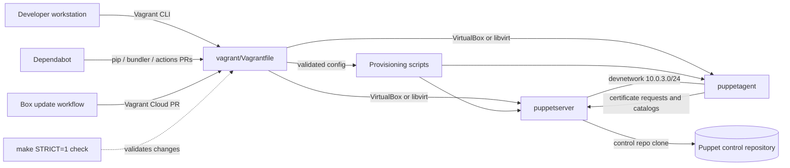
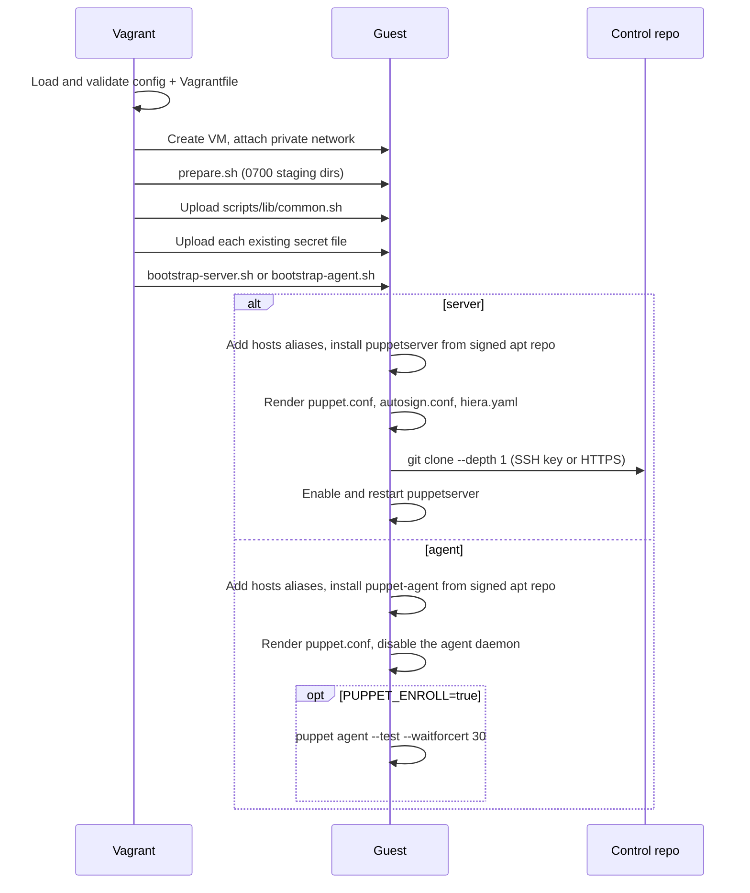

# Architecture

This document describes the Puppet development stack as implemented in this
repository: its components, contracts, runtime topology, and the controls that
keep it reproducible and reviewable. For setup instructions, see
[README.md](README.md).

## System context



The repository is the control plane; the two VMs are the runtime. Nothing in
the runtime depends on a host workspace mount or on credentials that are not
explicitly supplied by the developer.

## Components

| Component | Location | Responsibility |
| --- | --- | --- |
| Vagrant definition | `vagrant/Vagrantfile` | Loads and validates configuration, defines both VMs, providers, networks and provisioners. |
| Configuration | `vagrant/config/default.yaml` | Single source of truth for box, Puppet, network and node values. |
| Configuration template | `vagrant/config/default.yaml.example` | Documented, non-secret starting point for a custom config. |
| Config validator | `scripts/validate-config.py` | Enforces the same schema as the Vagrantfile without requiring Vagrant or Ruby. |
| Provisioning scripts | `vagrant/scripts/` | Idempotent, lintable guest bootstrap for each role, with shared helpers. |
| Generated-config references | `vagrant/puppet/*.conf.example` | Document the shape of `puppet.conf` rendered on each guest. |
| Ruby tooling | `vagrant/Gemfile` | Pins the Vagrant and RuboCop versions used for local linting. |
| Python tooling | `requirements-dev.txt` | Pins validation and security tooling used locally and by the check gate. |
| Build gate | `Makefile` | Exposes validation, lint, security and lifecycle targets. |
| Automation | `.github/` | Dependency updates and box pin updates. |

### Repository layout

```text
vagrant/       Vagrant stack: Vagrantfile, config, bootstrap scripts, Gemfile
docs/          Usage guide and this architecture document
scripts/       Config validation, security audit, box update tooling
.github/       Dependabot config and GitHub Actions workflows
Makefile       Validation, lint, security and lifecycle entry point
```

## Configuration model

`vagrant/config/default.yaml` is the only source of declarative input. The
Vagrantfile loads it with `YAML.safe_load_file(..., aliases: true)`, so only
plain data types are accepted. An alternative path can be supplied with
`PUPPETDEV_CONFIG`.

Two validators enforce the same contract:

- **Ruby, inside the Vagrantfile** - runs on every Vagrant command and aborts
  before any provider work if a value is invalid.
- **Python, `scripts/validate-config.py`** - runs without Vagrant, so malformed
  configuration fails early and with clear messages.

| Rule | Enforcement |
| --- | --- |
| Required sections `box`, `puppet`, `network`, `nodes`, `puppet.control_repo` | Both validators |
| Hostnames are lowercase RFC-style names | `HOSTNAME_RE` in Ruby, `HOSTNAME_RE` in Python |
| `network.subnet` is a valid IPv4 CIDR | `IPAddr` / `ipaddress` |
| `ip_octet` is 2-254 and unique per node | Both validators |
| `puppet.version` is 7 or 8 | Allowlist in both validators |
| Control repo URLs contain no whitespace and use HTTPS or SSH syntax | `URL_RE` in both validators |
| `memory_mb >= 512`, `cpus >= 1`, positive `boot_timeout` | Both validators |
| Optional `box.checksum` is a bare SHA-256/SHA-512 hex digest, mapped to Vagrant's `box_download_checksum` | Python validator and Vagrantfile |

Environment variables provide runtime overrides that do not belong in the
committed config: `PUPPETDEV_GUI` enables VM consoles, `PUPPET_ENROLL` requests
a Puppet certificate during agent bootstrap, `PUPPETDEV_SECRETS` relocates the
secret directory, and `PUPPETDEV_CONFIG` selects a different config file.

## Node topology

| Node key | Role | Hostname from config | Address derivation | Resources |
| --- | --- | --- | --- | --- |
| `puppetserver` | Puppet Server / certificate authority | `nodes.puppetserver.hostname` | subnet host part + `ip_octet` 42 | 2048 MB, 2 vCPU |
| `puppetagent` | Puppet agent | `nodes.puppetagent.hostname` | subnet host part + `ip_octet` 43 | 1024 MB, 1 vCPU |

With the committed defaults, the internal network is `10.0.3.0/24` and the
nodes are `10.0.3.42` and `10.0.3.43`. Addresses are computed with Ruby's
`IPAddr#|`, so changing the subnet in one place updates every node. The
`puppet` alias points at the server address so agent configuration stays
stable if hostnames change.

Both VirtualBox and libvirt provider blocks are declared. Vagrant applies only
the active provider's settings; VirtualBox uses an internal network named by
`network.internal_network`, and libvirt uses a network of the same name.
Linked clones and a headless console are the defaults; `vb.gui = true` is
available for interactive debugging.

## Provisioning lifecycle



Every script starts with `set -Eeuo pipefail`. `common.sh` supplies
`write_if_changed`, `add_host_alias`, `install_secret`, `apt_install` and
`debian_codename`, so re-running provisioning converges without duplicating
hosts entries or rewriting unchanged config. Secrets are staged only when the
corresponding local file exists; their absence is a logged warning, not a
failure.

Vagrant's file provisioner uploads over SCP as the unprivileged SSH user, so
`prepare.sh` creates the `0700` staging tree and then hands it to that user
(`SUDO_USER`, falling back to `vagrant`); otherwise the uploads would fail with
`SCPPermissionDenied`. Each bootstrap script removes the staged secrets on exit
via a trap, so private material never lingers in the guest's `/tmp`.

### Puppet runtime

Puppet 8 packages come from Puppet's signed apt repository, configured by the
official `puppet8-release-bookworm.deb` package. Configuration lives under
`/etc/puppetlabs/puppet`, and the server runs as the `puppetserver` service.

The server manages an environment path, a name-pattern autosign file for the
development domain, an optional hiera configuration, and an optional hiera-eyaml
key pair. The control repository is shallow-cloned into
`environments/${PUPPET_ENVIRONMENT}` so the directory always matches the
environment both nodes request; an SSH deploy key is used when supplied,
otherwise the clone uses HTTPS.

The agent runs onetime with splay enabled and no background daemon.
Certificate enrollment is opt-in: set `PUPPET_ENROLL=true` for the first boot,
then sign the request on the server with:

```bash
sudo /opt/puppetlabs/bin/puppetserver ca list
sudo /opt/puppetlabs/bin/puppetserver ca sign --certname <agent certname>
```

Name-based autosigning is a development convenience. Restrict it to the dev
domain and use explicit CA signing in shared or production environments.

## Security architecture

| Boundary | Controls |
| --- | --- |
| Host to guest | Key-only SSH (`keys_only`, `insert_key`), no password, no agent or X11 forwarding, no `/vagrant` synced folder. |
| Guest to upstream | Pinned box version with optional SHA digest, signed apt repositories, HTTPS control repo clone by default, persistent host-key TOFU for SSH clones. |
| Repository to secrets | Secrets live only in ignored `vagrant/secrets/`, are uploaded as individual files, and are installed with restrictive modes and owners. |
| Provisioning integrity | External lintable scripts, strict shell mode, idempotent writes, least-privilege package set with `--no-install-recommends`. |
| Supply chain | Pinned Python and Ruby manifests, Dependabot for pip/bundler/Actions, weekly box pin checks, and `pip-audit` / `gitleaks` in the local check gate. |

No credential is required for a default `vagrant up`. The deploy key and
eyaml keys are optional enhancements for a private control repository.

## Build, test and release pipeline

`make check` is the single gate and expands to validation, lint and security:

| Stage | Commands |
| --- | --- |
| Validation | `vagrant validate --ignore-provider`, `scripts/validate-config.py` |
| Lint | `yamllint` (all YAML), `shellcheck` (all scripts), `rubocop` (Vagrantfile and Gemfile) |
| Security | `scripts/security-audit.sh`, `gitleaks`, `pip-audit`, `scripts/check-box-update.py --check` |

`--ignore-provider` lets the gate validate the Vagrantfile without installing a
hypervisor. Tools that are absent are reported as `SKIP`; `STRICT=1` turns
every skip into a hard failure and is the mode used for automated validation.
Local development can use
the lifecycle targets `up`, `status`, `provision`, `halt`, `destroy`,
`ssh-server` and `ssh-agent`, with `VM=<node key>` to scope an operation.

Automation keeps the pinned dependencies current:

- Dependabot updates Python tooling, Ruby/Vagrant tooling and GitHub Actions
  weekly, with grouped PRs.
- `box-update.yml` queries Vagrant Cloud weekly and opens a PR when a newer
  release still publishes a VirtualBox provider.
- Review every proposed update with the same `make STRICT=1 check` gate before merging.

## Extension points

| Goal | Change |
| --- | --- |
| Add a node | Add it to `NODE_NAMES` in the Vagrantfile and to `nodes` in the config, with a unique `ip_octet` and a role script under `vagrant/scripts/`. |
| Change the base image | Update `box.name`, `box.version` and, when available, `box.checksum` in the config. |
| Use libvirt | Run `vagrant up --provider=libvirt`; the provider block and network name are already configured. |
| Use a private control repo | Place `puppet_control_deploy_key` in `vagrant/secrets/` or point `puppet.control_repo.https` at an accessible repository. |
| Enable hiera-eyaml | Place `eyaml_private_key.pem` and `eyaml_public_key.pem` in `vagrant/secrets/`. |
| Debug in the GUI | Set `gui: true` in the config or `PUPPETDEV_GUI=true` in the environment. |
| Personalise without forking | Point `PUPPETDEV_CONFIG` at a config file outside the repository. |

## Failure modes

| Symptom | Likely cause | Check |
| --- | --- | --- |
| `Configuration file not found` | Wrong working directory or config path | `make validate-config` |
| `vagrant validate` rejects a value | Schema violation | Error message names the exact key |
| Puppetserver will not start | Insufficient memory or a bad FQDN | `journalctl -u puppetserver -f`, raise `memory_mb` |
| Agent cannot reach the server | Host alias or subnet mismatch | `/etc/hosts` on both nodes, `network.subnet` |
| Control repo clone fails | Wrong URL, branch or key permissions | `puppet.control_repo.*`, key mode `0600` |
| Certificate enrollment stalls | Request not signed | `puppetserver ca list` on the server |
| `make lint` reports SKIP | Optional tool not installed | Install it, or run with `STRICT=1` for the exact requirement |
